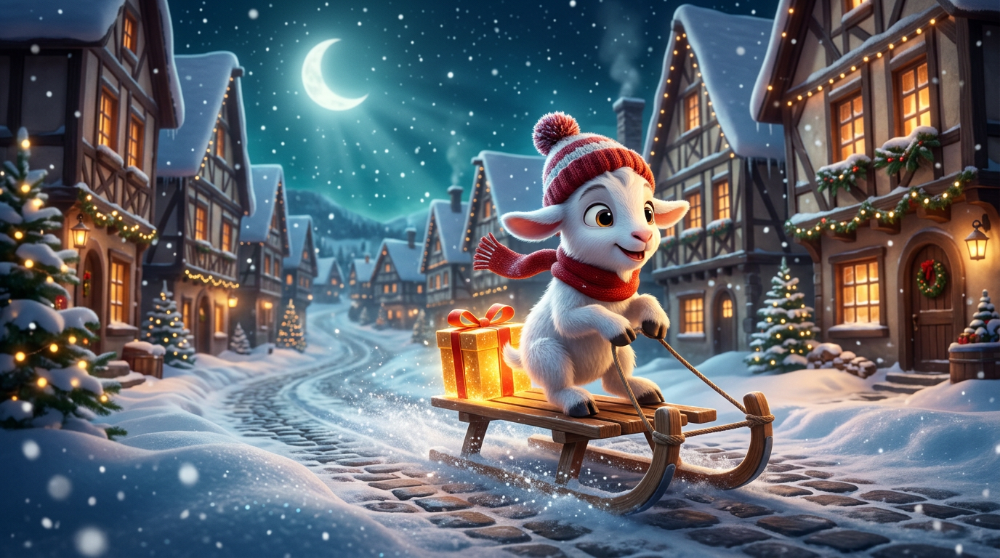
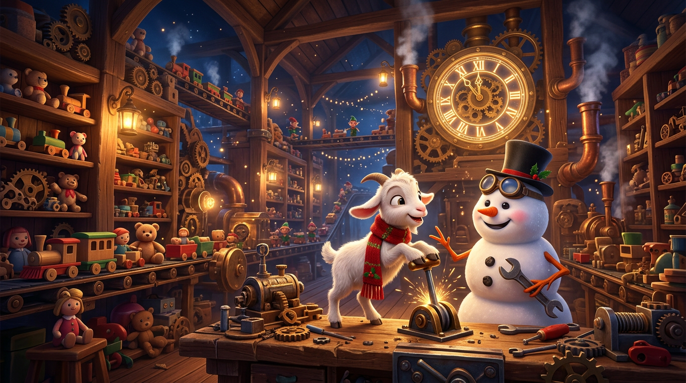
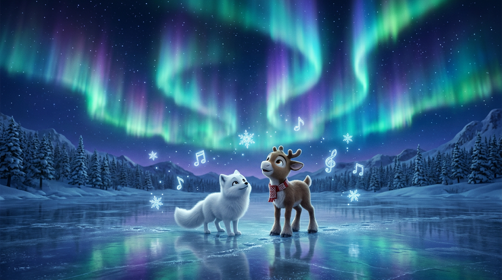

# Три концепции проекта (старшая категория, Scratch 3.0)

Общая рамка для всех вариантов — «Pixar-качество на Scratch»:

- **Стиль**: тёплый свет против холодной ночи (главный приём Pixar: `#0B1B33` синий + `#FFC96B` золотой), большие глаза, мягкие округлые формы, объёмные фоны в 4 слоя.
- **Техническая база** (общая для всех): рендер-обёртки нет, значит «вау» делается **параллаксом из клонов**, **частицами снега**, **динамической камерой (тряска)**, **слоями света/виньетки** и **кинематографичными переходами**.
- **Символ 2027 года** — Коза (стихия Огня). Во всех вариантах козочка = главный герой или ключевой персонаж. Это и «соответствие тематике» на 3 балла, и узнаваемость.
- **Звук**: оригинальный синтезированный саундтрек (без рисков по авторским правам) + ИИ-озвучка диалогов (разрешена п. 7.3) + фоли собственной генерации.

---

## Вариант A — «Последняя посылка» (The Last Parcel)
**Жанр:** кинематографичный сайд-скроллер-платформер с бегом на санях.
**Логан:** До Нового года две минуты. Козочка Мила — курьер Деда Мороза, и осталась одна посылка: та, что спасёт праздник в доме на холме. Сани, метель и часы, которые не ждут.

**Почему это «вау»:** самый «пиксаровский» из трёх. Много движения и света: параллакс улиц, искры из-под полозьев, снег с ветром, камера трясётся на ударах, в финале — фейерверк над городом и титр «2027».

### Логическая структура (ровно как просит п. 7.3 — «на 3 балла»)
| Блок | Что происходит | Длит. |
|---|---|---|
| **0. Пролог (завязка)** | Мастерская Деда Мороза. Часы «23:58». Дед Мороз: «Мила, посылка №2027 не доставлена!» Мила: «Успею!» — проблема озвучена, время/место/герои заданы | ~25 с |
| **1. Акт «Ночной город»** | Сани летят по улице: прыжки через сугробы, сбор 5 звёзд, 3 жизни. Управление: ←/→ и пробел | ~70 с |
| **2. Акт «Зимний лес»** | Платформы, движущиеся пни, сова-подсказчик, ветер сбивает. Нужно 3 звезды для «разгона» | ~70 с |
| **3. Акт «Крыша» (кульминация)** | Метель-босс бросает снежки, нужно попасть в трубу. Таймер до полуночи (60 с), жизни | ~60 с |
| **4A. Победа** | Посылка в трубе, окно загорается тёплым светом, фейерверк, козочка в шапке «2027», титры «С Новым годом!» + кнопка «Ещё раз» | ~15 с |
| **4B. Проигрыш** | Метель побеждает, экран «Часы пробили полночь…», кнопка «Попробовать снова» → полный сброс | ~8 с |

**Ассеты:** 6 фонов (мастерская, город-день/ночь, лес, крыша, финал-победа, финал-проигрыш) + 4 слоя параллакса; ~34 спрайта (Мила 6 поз, сани, Дед Мороз 2 позы, снеговик, сова, метель-босс 3 кадра, снежок, звезда, подарок, труба, окно, сугроб, пень, ёлки 2 вида, фонарь, дым, снежинки 3 вида, UI: часы, сердце-жизнь, счёт, кнопки).
**Звук:** тема «Курьер» (вальс с бубенцами), тема «Лес» (арфа+флейта), тема «Финал» (оркестровая кульминация + колокола), фоли: скрип снега, «вжух» саней, звон подбора, удар, тиканье, ветер, фейерверк; озвучка 6 реплик (Мила, Дед Мороз, Метель).
**Сложность реализации:** средняя-высокая (физика + 3 акта + босс). **Риск:** тайминг платформера на 3 акта — самый долгий в балансировке.
**Прогноз по критериям:** тематика 3, работоспособность 3, оформление 3, сложность 3, звук 3 → **15/15** при аккуратной сборке.

---

## Вариант B — «Фабрика чудес» (Wonder Factory)
**Жанр:** платформер-головоломка с механизмами (конвейеры, шестерни, рычаги) в мастерской Деда Мороза.
**Логан:** Козочка Мила дёрнула не тот рычаг — и гигантские часы встали. Пока стрелки не дошли до полуночи, нужно вернуть три шестерни на место и запустить машину подарков.

**Почему это «вау»:** самый «богатый» кадр — тёплый интерьер, пар, пылинки в луче света, латунь, дерево. И самая «умная» механика: не просто беги, а **пойми, какой конвейер куда ведёт** (переключатели меняют путь шестерни). Жюри любит «развёрнутую логику».

### Логическая структура
| Блок | Что происходит |
|---|---|
| **0. Пролог** | Мастерская, часы «23:59», рычаг, авария, диалог Милы и Снеговика-механика (проблема: часы стоят → подарки не успеют) |
| **1. Цех конвейеров** | Платформер по конвейерам; собрать шестерню №1; переключатели `1/2` меняют направление ленты |
| **2. Башня часов** | Вертикальный подъём по шестерням-лифтам, шестерня №2, узкий тайминг |
| **3. Машинный зал** | Мини-головоломка: выставить 3 рычага в комбинацию из подсказки (сова показывает символы), вставить шестерню №3 |
| **4A. Победа** | Часы бьют, машина оживает, из трубы летят подарки, «2027» из искр, титры |
| **4B. Проигрыш** | Полночь, часы не запущены, конфетти гаснет, «Ещё раз» |

**Ассеты:** 5 фонов + слои параллакса (интерьер в глубину), ~38 спрайтов (Мила, Снеговик-механик, эльфы на заднем плане, конвейер 3 сегмента, 3 шестерни, 3 рычага, стрелки часов, маятник, пар, пылинки, свеча, ёлочные игрушки, ёлки, UI).
**Звук:** тема «Мастерская» (стальной марш на ксилофоне + бас), тема «Башня» (тик-так как ритм-основа), финал (колокола + оркестр); фоли: лязг шестерни, пар, скрип дерева, бой часов, конфетти; 8 реплик.
**Сложность реализации:** высокая (механика переключателей + головоломка + вертикальный уровень). **Риск:** баланс головоломки для 10–11 лет и защита от «застрял — и всё».
**Прогноз по критериям:** тематика 3, работоспособность 3, оформление 3, сложность 3, звук 3 → **15/15**, но выше риск «незначительных ошибок» из-за количества механик.

---

## Вариант C — «Полярное сияние» (Aurora)
**Жанр:** музыкальная аркада-ритм (лови снежинки-ноты в такт) + история дружбы лисёнка и оленёнка.
**Логан:** Полярная ночь, сияние погасло, и звёзды перестали звенеть. Лисёнок и оленёнок собирают мелодию Рождества по нотам, рассыпанным по льду.

**Почему это «вау»:** самый красивый визуально (сияние, отражения во льду, ноты-снежинки) и самый сильный по звуку: **музыка — это геймплей**, попадание в ритм даёт очки, промах гасит сияние. Такого на конкурсе почти не бывает.

### Логическая структура
| Блок | Что происходит |
|---|---|
| **0. Пролог** | Лёд, тишина, сияние гаснет, диалог лисёнка и оленёнка (проблема: «Рождество без музыки») |
| **1. Песня 1 «Колыбельная»** | 60 с, 3 дорожки нот, комбо-счётчик, шкала «сияние» |
| **2. Песня 2 «Вальс снежинок»** | быстрее, добавляются «фальшивые» ноты-ловушки (чёрные) |
| **3. Песня 3 «Финал»** | обе темы вместе, сияние разгорается, звёзды зажигаются |
| **4A. Победа** | небо вспыхивает, «2027» из звёзд, титры |
| **4B. Проигрыш** | сияние гаснет, «Ещё раз» |

**Ассеты:** 4 фона (лёд, лес, небо-сияние ×2 состояния), ~20 спрайтов (лисёнок 4 кадра «танец», оленёнок, ноты 4 вида, ловушки, звёзды, снег, шкала сияния, UI, кнопки).
**Звук:** 3 полноценных оригинальных трека + фоли (льдинки, «дзынь», комбо) + 4 реплики.
**Сложность реализации:** средняя (ритм на таймерах), но **самый высокий риск по критерию «путь героя»**: жюри может не увидеть «игру, где описывается путь героев к цели» в чистом ритме — нужно добавлять сюжетную обвязку.
**Прогноз:** тематика 3, работоспособность 3, оформление 3, сложность 2 (риск), звук 3 → **14/15**, при удачной обвязке — 15.

---

## Сравнение

| | A «Последняя посылка» | B «Фабрика чудес» | C «Полярное сияние» |
|---|---|---|---|
| «Пиксаровость» кадра | ★★★ | ★★★ | ★★★ |
| Движение/динамика | ★★★ (сани, метель, босс) | ★★☆ (механизмы) | ★★☆ (ритм) |
| Логическая сложность для жюри | ★★★ | ★★★ (головоломка) | ★★☆ |
| Риск не успеть/ошибок | ★★☆ | ★★★ (высокий) | ★☆☆ |
| Уникальность на конкурсе | ★★☆ | ★★☆ | ★★★ |
| **Итог** | **оптимум: максимум баллов при понятном сюжете** | самый «умный», но рискованный | самый красивый и музыкальный |

### Рекомендация
**A «Последняя посылка»** — лучший баланс: сюжет буквально совпадает с формулировкой критерия на 3 балла («начало игры: время, место, герои, проблема»), много движения = «вау», и это реально собрать и отладить за сутки.

**Сильный гибрид, если хочется больше музыки:** A с прологом/финалом уровня C — то есть саундтрек-лейтмотив и финальный кадр «сияние + 2027». Это включено в план A по умолчанию (лейтмотив Козы из 4 нот проходит через все три темы — приём Pixar).
